# Медовая ловушка

AvitoCTF 2026 · **Автор задания:** Даниил Рязанцев

## Описание

>
>Рабочий компьютер нашего мёдгалтера взломали! Это явно фишинг пчёлинг, на подпольных пчелиных форумах давно торгуют линукс-руткитом eBee.
>Мы сняли дамп памяти с машины — проверишь его?
>Мы сняли дамп памяти с машины — проверишь его?
>

---

## Решение

Ну собсна дан нам дамп оперативной памяти линух машины. (Ссылка на дамп оперативной памяти: https://t.me/avitoctf_chat/1235)

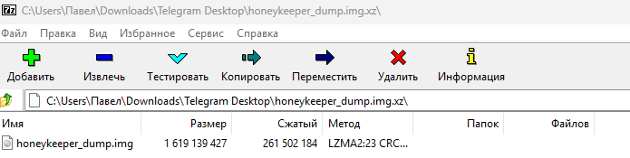

Для анализа надо определить версию ядра и дистрибутива, так как volatility без таблицы debug символов не будет работать.

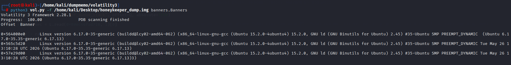

Так как у меня таблица debug символов собрана, то я пожалуй опущу момент с сборкой, а сразу преступлю к анализу. В целом всё по базе: чекаем процессы и прочую хуету, которая может быть подозрительна

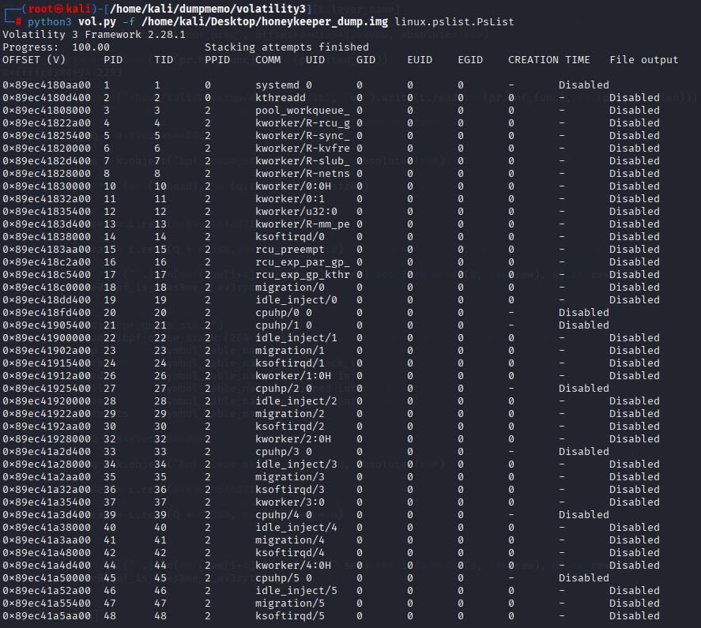

Pslist даёт дохуя, но ничего прям подозрительного нет, погнали чекать дальше (для чайников: pslist выводит список запущенных процессов)

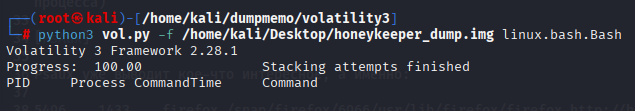

Bash вообще пустой (он или не запускался, или в дампе ничего не сохраннилось), давайте тогда чекнем PsAux (для чайников №2: PsAux выводит тот же список процессов, что и pslist, но даёт ещё и аргументы процесса)

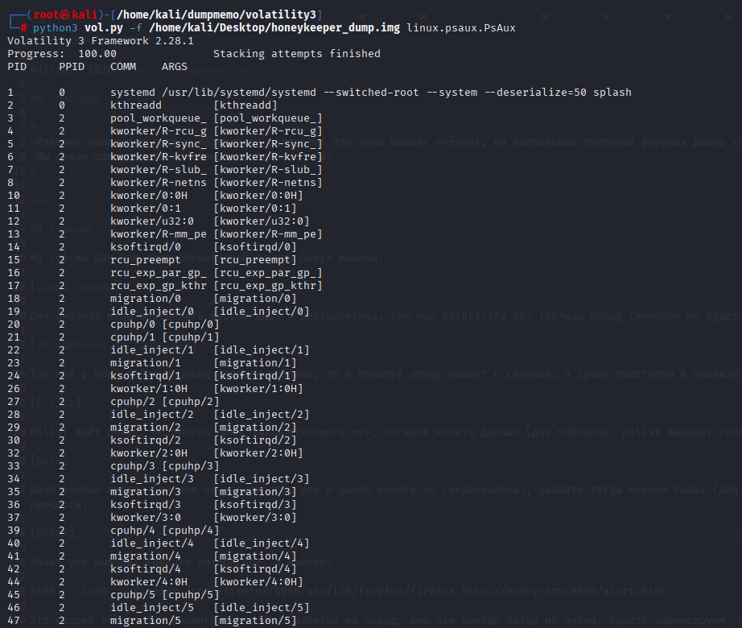

Psaux уже выводит кое-что интересное, а именно:
```
5496    1433    firefox /snap/firefox/6966/usr/lib/firefox/firefox http://honey-crm:8000/alert.html
```
Это скорее всего сама фишинговая ссылка (забегая на перёд, она нам вообще нахуй не нужна, просто зафиксируем, что оно есть)

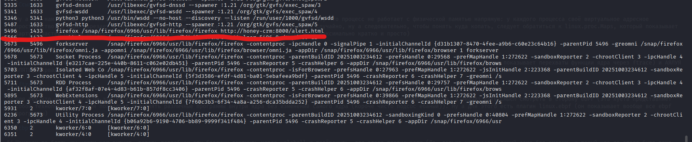

Ну а как нам вообще в целом флаг то достать при таких вводных? А вот тут стоит вспомнить про то, что процесс не работает с физической памятью напрямую: у каждого процесса своё виртуальное адресное пространство, а ядро нарезает в нём области, при этом физически страницы этих областей лежат случайно, ну а следовательно, чтобы понять куда копать, следует обратиться к linux.proc.Maps, который показывает карту областей памяти процесса (заранее извиняюсь за неточности или ошибки, пытался объяснить максимально кратко и просто)

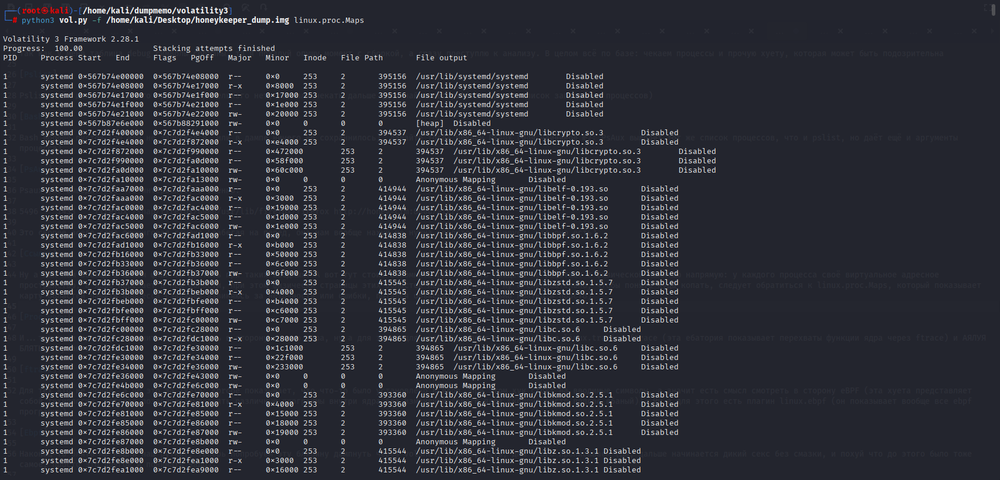

И...тут тоже промах, а значит пора смотреть в сторону самого ядра, ну а для этого мы может воспользоватся linux.tracing.ftrace (эта ебатория показывает перехваты функции ядра через ftrace) и АЯЛУЯ БЛЯТЬ, первая зацепка

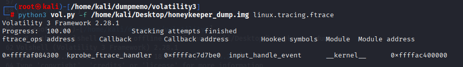

Для тех кто не понял, а чё это за хуета: Kprobe показывает, что что-то было установлено в ядро, при этом хук стоит на вводимые символы, а значит есть смысл смотреть в сторону eBPF (эта хуета представляет собой технологию, которая позволяет выполнять различные программы внутри ядра без изменений самого ядра (короче чисто подсос ебаный)). Ну а для этого есть плагин linux.ebpf (он показывает вообще все ebpf программы)

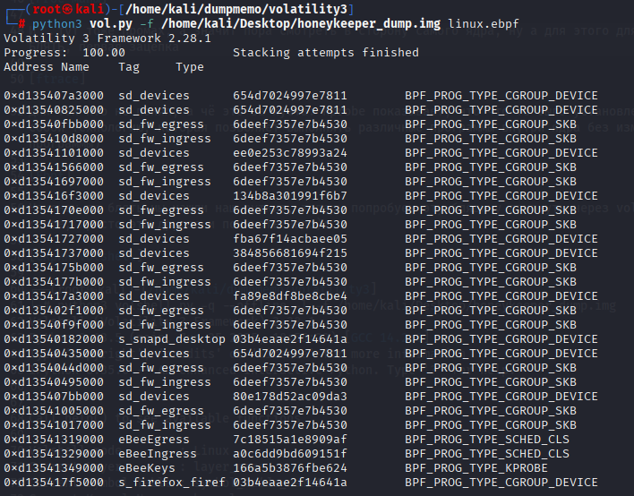

Наконец-то блять мы нашли наш руткит, теперь попробуем эту блядину дампнуть через volshell и ревёрснуть, для этого прописываем (Да, дальше начинается дикий секс без смазки, и похуй что до этого было тоже самое, просто это другое и понимать надо):

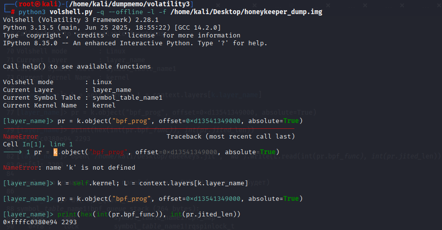

А ещё надо узнать смещение полей (это нам ПИЗДЕЦ как нужно будет)

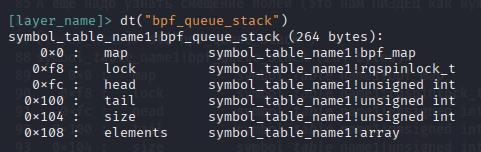

Соответственно для такой хуеты нужна гидра

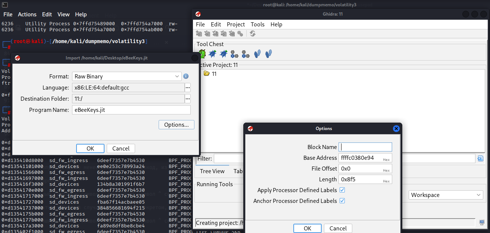
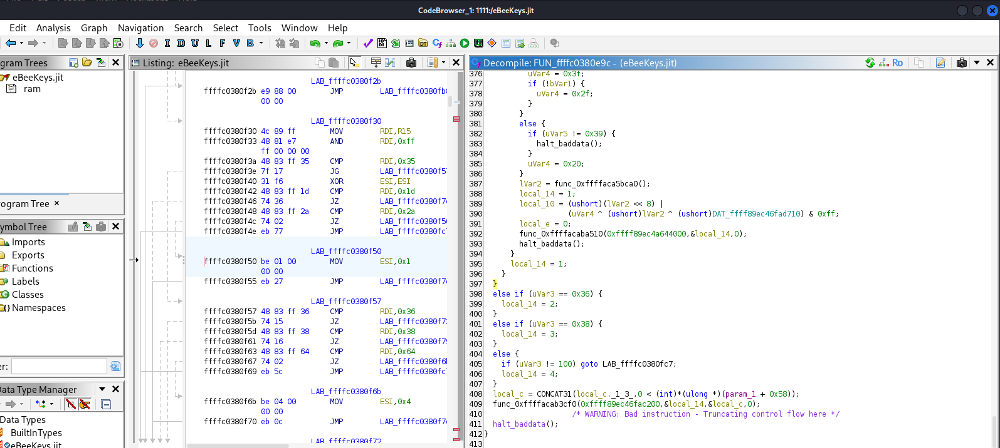

Ну и уже получаем более менее читаемый псевдокод, из которого получаем следующее: 

Формула шифрования: 

зашифрованный символ = символ ^ случайный символ ^ секрет

Каждое нажатие XOR-ится случайным байтом и секретом, но при этом случайный байт кладётся в ту же запись. Поэтому обращение у нас выглядит так:

символ = зашифрованный символ ^ случайный символ ^ секрет

Ну собственно по факту расположение всего необходимого говна нам известно из того же псевдокода

Секрет - 0xffff89ec46fad710
Зашифрованный текст - 0xffff89ec4a644000 со смещением + 0x108
Случайный символ - следующий символ после зашифрованного символа 

Ну и блять наконец мы доходим до расшифровки всей этой залупы (наконц-то этот кошмар закончился)

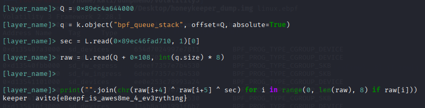

Флаг: avito{eBeepf_is_awes8me_4_ev3ryth1ng}

Моё мнение на счёт этого таска: я рот шатал это говно, так как если говорить про этап разведки, то оно более менее норм, но разбор eBPF программы просто лютый секс, который сводит на нет любые положительные эмоции во время решения задачи (да, впервые за время публикации райтапов решил оставить своё мнение о таске)
